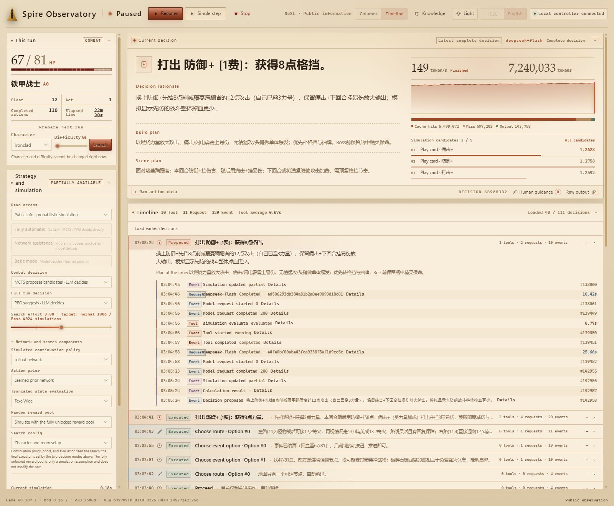

<!-- Public overview and setup instructions for SlayTheSpire2-Agent-Expert. -->
# SlayTheSpire2-Agent-Expert


[](https://github.com/LostPatrol/SlayTheSpire2-Agent-Expert/commits/main)

[中文文档](README.zh-CN.md)

An AI agent for *Slay the Spire 2* on Windows, using a game mod's structured observations and action interface.

- Supports DeepSeek decisions, MCTS combat simulation, and a PPO policy for full runs.
- Provides a bilingual local dashboard for streaming reasoning, action receipts, full history, and budgets, with pause, resume, single-step, and manual guidance.
- Includes an English and Chinese static knowledge base; the model and public simulations use public information by default.
- Supports all five characters and A0–A10 configurations.

<p align="center">
  <a href="docs/images/dashboard-en-light.jpg"></a>
  <br>
  <sub>Spire Observatory · recorded session replay; historical content remains in its original language.</sub>
</p>

> [!NOTE]
> Currently targets the Steam main branch, `v0.107.1`.
> The project is still in development; full content coverage, fully autonomous completion, and formal win-rate evaluation remain unfinished.

For reference, using `deepseek-v4.1-flash1017` with simulation assistance and `low` reasoning effort has a very high chance of reaching floor 48 and a fairly high chance of clearing A0. A full run uses about 50M–60M tokens, takes more than two hours, and costs about CNY 8.5 in API usage. Without simulation assistance, the chance of reaching floor 48 falls, and the chance of clearing the run falls substantially.

## Setup

Requires a licensed Steam copy of the game, uv, MSVC C++ Build Tools, and the Windows SDK.

```powershell
git clone https://github.com/LostPatrol/SlayTheSpire2-Agent-Expert.git
Set-Location SlayTheSpire2-Agent-Expert
.\scripts\setup.ps1
```

Set the game installation path and `client_id` in `configs/machine.json`, using **your own fully unlocked Steam main save or a separate copy of it**.
Saves are located at `%APPDATA%\SlayTheSpire2\default\<client_id>\modded\profile<number>\saves`.

Close the game before building:

```powershell
.\scripts\setup-mentor.ps1
.\scripts\build-bridge.ps1
.\scripts\build-simulation.ps1 -FetchDependencies
```

## Usage

To use the language model, create `secrets/` and put your API key in `secrets/apikey-deepseek.txt`, or set `DEEPSEEK_API_KEY` for the current process.
No language-model calls are made when both combat and noncombat decisions are handled directly by the simulation policies.

1. Double-click **启动仪表盘.cmd** in the project root to open the local dashboard at `http://127.0.0.1:18766`.
2. Click **Launch game** (启动游戏).
3. Click **Start automatic play** (开始自动游玩).

Without opening a browser:

```powershell
.\scripts\start-dashboard.ps1 -Config configs/a0-simulation.json -NoBrowser
.\scripts\run-agent.ps1 -Command inspect
```

[Run guide](docs/local-runbook.md) · [Combat simulation](docs/combat-simulation.md)

## Development

```powershell
.\.venv\Scripts\python.exe -m pytest -q
node --test tests/test_dashboard_timeline.js tests/test_dashboard_usage.js tests/test_dashboard_language.js
```

[Documentation index](docs/README.md)

## Credits and licenses

Thanks to [CharTyr/STS2-Agent](https://github.com/CharTyr/STS2-Agent), [tfriedel/spire-mentor](https://github.com/tfriedel/spire-mentor),
[evangambit/sts2](https://github.com/evangambit/sts2), and [ptrlrd/spire-codex](https://github.com/ptrlrd/spire-codex).

Each component retains its own license: AGPL-3.0 for the game bridge, MIT for Mentor and the C# rules core, and PolyForm Noncommercial 1.0.0 for Spire Codex data.
See [third-party sources](docs/third-party.md) and the included licenses. Game content belongs to Mega Crit; this project does not include the game binaries.
