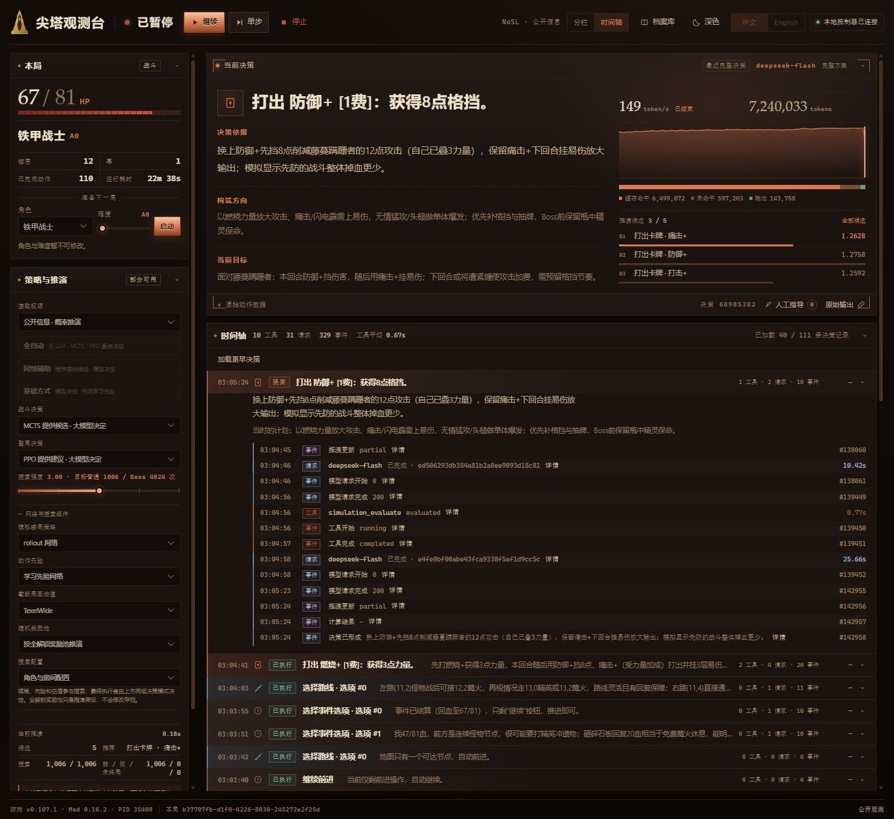
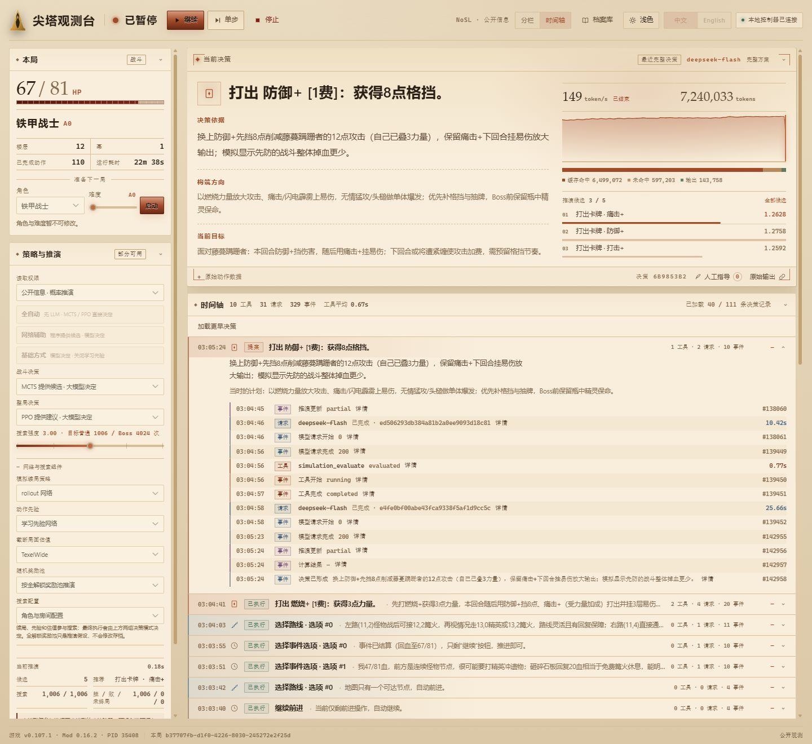

<!-- Public overview and setup instructions for SlayTheSpire2-Agent-Expert. -->
# SlayTheSpire2-Agent-Expert


[](https://github.com/LostPatrol/SlayTheSpire2-Agent-Expert/stargazers)
[](https://github.com/LostPatrol/SlayTheSpire2-Agent-Expert/commits/main)

[English](README.md)

在 Windows 运行 *Slay the Spire 2* 的 AI Agent，通过游戏 Mod 的结构化观测与动作接口操作游戏。

- 支持 DeepSeek 决策、 MCTS 战斗推演以及 PPO 整局策略。
- 提供中英文本地仪表盘，查看流式推理、动作回执、完整历史与预算，支持暂停、继续、单步和人工指导。
- 内置中英文静态知识库；默认模型与公开推演使用公开信息。
- 支持五角色和 A0–A10 配置。

<p align="center">
  <a href="docs/images/dashboard-zh-dark.jpg"></a>
  <br>
  <sub>尖塔观测台 · 夜间主题 · 对局记录回放，历史内容按原文保留。</sub>
</p>

<details>
  <summary>白天主题</summary>
  <p align="center">
    <a href="docs/images/dashboard-zh-light.jpg"></a>
    <br>
    <sub>尖塔观测台 · 白天主题 · 对局记录回放，历史内容按原文保留。</sub>
  </p>
</details>

> [!NOTE]
> 当前适配 Steam 主分支 `v0.107.1`。
> 项目仍在开发，完整内容覆盖、纯自主通关及正式胜率评估尚未完成。

一个可参考的效果是：使用deepseek-v4.1-flash1017，开启推演辅助，推理强度为low，极高概率爬至48层 ，较高概率通关A0；整局总token约为50M-60M，耗时2小时以上，API成本 8.5 元。关闭推演辅助，则爬至48层概率下降，且通关概率显著下降。


## 准备

需要正版 Steam 游戏、uv，以及 MSVC C++ 构建工具和 Windows SDK

```powershell
git clone https://github.com/LostPatrol/SlayTheSpire2-Agent-Expert.git
Set-Location SlayTheSpire2-Agent-Expert
.\scripts\setup.ps1
```

修改 `machine.json` 中的游戏安装目录与 `client_id`，选用**自己的 Steam 全解锁主存档或其独立副本**。
存档位于 `%APPDATA%\SlayTheSpire2\default\<client_id>\modded\profile<编号>\saves\`。

关闭游戏后构建：

```powershell
.\scripts\setup-mentor.ps1
.\scripts\build-bridge.ps1
.\scripts\build-simulation.ps1 -FetchDependencies
```

## 使用

使用大模型时，创建 `secrets/` 并把  API 密钥放入 `secrets/apikey-deepseek.txt`，也可设置当前进程的 `DEEPSEEK_API_KEY`。将战斗和整局都设为由推演直接决定时，不调用大模型。

1. 双击根目录 **启动仪表盘.cmd**，打开本地网页 `http://127.0.0.1:18766`。
2. 点击 **启动游戏**。
3. 点击 **开始自动游玩**。

无网页：

```powershell
.\scripts\start-dashboard.ps1 -Config configs/a0-simulation.json -NoBrowser
.\scripts\run-agent.ps1 -Command inspect
```

[运行手册](docs/local-runbook.md)  [战斗推演](docs/combat-simulation.md)。

## 开发

```powershell
.\.venv\Scripts\python.exe -m pytest -q
node --test tests/test_dashboard_timeline.js tests/test_dashboard_usage.js tests/test_dashboard_language.js
```

[文档索引](docs/README.md)

## 来源与许可

感谢 [CharTyr/STS2-Agent](https://github.com/CharTyr/STS2-Agent)、[tfriedel/spire-mentor](https://github.com/tfriedel/spire-mentor)、
[evangambit/sts2](https://github.com/evangambit/sts2) 和 [ptrlrd/spire-codex](https://github.com/ptrlrd/spire-codex)。

各组件适用各自许可：游戏桥为 AGPL-3.0，Mentor 与 C# 规则核心为 MIT，Spire Codex 静态资料为 PolyForm Noncommercial 1.0.0。
详见[第三方来源](docs/third-party.md)及随附许可。游戏内容版权属于 Mega Crit，本项目不包含游戏程序。
