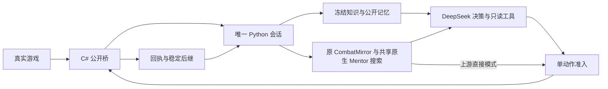

<!-- Current architecture, execution invariants, and extension points. -->
# 架构与扩展入口

游戏通过 C# 桥导出白名单公开状态；唯一 `DashboardSession` 负责观测、预算、决策、原子准入、回执与稳定后继。战斗与整局分别选择大模型、上游网络辅助或上游直接执行；上游直接模式不调用模型 API，不支持的局面明确暂停。FastAPI 网页与 CLI 共用会话，服务启动保持暂停。日常配置为 `configs/a0-simulation.json`。

## 修改入口

| 修改内容 | 入口 |
|---|---|
| 公开字段、操作权限、token | `vendor/STS2-Agent` 的 `FairDecisionProtocol`、`GameStateService`、`PublicRulesText` |
| 原子执行与幂等回执 | 桥 `GameActionService`、`Router` |
| HTTP、进程绑定、稳定等待 | `src/sts2_agent/bridge.py` |
| 单会话、预算、暂停、恢复、提案 | `session.py`；CLI 包装 `controller.py` |
| 当前动作验证、公开历史 | `public.py`、`public_history.py`、`rules.py` |
| 模型请求、固定提示、上下文 | `provider.py`、`prompt_context.py`、`prompt_projection.py` |
| 只读工具、知识、攻略 | `model_tools.py`、`knowledge.py`、`strategies.py` |
| 公开记忆、指导、自动流程 | `memory.py`、`instructions.py`、`automatic.py` |
| 镜像、动作坐标与推演协议 | `src/sts2_agent/mentor_runtime.py`、`experiments/mentor_simulation/host/src/public.rs`、`production.rs` |
| 上游网络与决策适配 | 同目录 `networks.rs`、`mcts.rs`、`ppo.rs`；直接使用上游编码器/推理/策略入口 |
| 上游及公开适配整局对照 | 同目录 `alignment.rs` 与 `experiments/solver_validation/` |
| 推演 IPC、episode 额度、摘要 | `src/sts2_agent/simulation.py` |
| 原生差分与批量验证 | `experiments/native_oracle/`、`experiments/combat_simulation/` |
| 冻结基线与策略实验 | `experiments/policy_evaluation/benchmark.py` |
| 启动、网页、日志、复盘 | `game_launcher.py`、`dashboard.py`、`web/`、`telemetry.py`、`replay.py` |

## 信息与执行边界

模型只接收公开状态、同局公开记忆及冻结知识。公开以人类理论可观察或推断为准，内部字段不自动视为作弊。原 CombatMirror 可读取真实牌序、RNG 与机械状态校准已发生事件；这些数据保留在独立私域。公开搜索先克隆镜像，再在先验、过滤和预览之前运行 BeliefDraw；内部模式允许真值未来推演。只读工具不能执行真实动作。原生 DLL oracle 是离线测试参照。

桥在游戏线程中校验公开 token、当前合法句柄和操作权限，再执行动作；相同 action_id 返回原回执。Python 的预算与单写入账本不由桥代管。HTTP 失响应只查同一 PID/instance_id 的回执，不再次 POST。不得盲删 `local/pending-action.json` 绕过未明动作。

策略完成后再次取得 settled 观测才准入，每个真实动作后重新观察。战斗要求原生玩家 `Phase == Play`、合法操作权限及连续两次 ready 稳定帧；选牌和弹窗沿用各自权限。保留保守稳定等待，不能将该条件宣称为所有延迟抽牌已经结束的证明。

`automatic.py` 只处理已审核的公开单步流程，复用相同准入/回执链；卡牌奖励打开后交给配置的执行者，有药水取舍时不自动代选。上游模式按原策略顺序先处理满栏换药，再处理卡牌奖励；实际原生领取许可优先于空槽推断。SpeedX 已有独立配置，不能通过压缩稳定等待替代游戏加速。

## 会话与持久性

`local/dashboard-session.json` 保存预算、公开记忆、指导、缓存提案与在途动作。普通暂停可接收完整响应，恢复时重新校验；重决策增加 epoch，但同一公开决策点沿用 episode。工具续接、重试和格式修复均消耗请求预算；暂停、停服及规则升级不退款。

未提交提案绑定提示/schema、知识快照、工具编码和实际推演规则身份。规则改变只废弃旧提案，保留在途原生证据。终局冻结耗时与结果，桥断连不覆盖终局。新局按标准启动器归档旧账本，沿用同一 clientId/profile 累积解锁。

战斗计数器随本局持久化，同一 episode 重试复用；旧局仅按已见公开 episode 恢复并注明边界。PPO 续体计划随待提交动作保留，只有原生接受回执才提交；未知 POST 不提前改变策略上下文。满栏换药是丢弃、重新观察、领取三个阶段，不能假装成一个原生原子动作。

动作提交、预算及生命周期变化仍立即持久化；推演、计算和工具开始展示合并账本写入，工具完成/失败仍持久化，完整事件日志保留。`stage-timings.jsonl` 记录阶段耗时和稳定轮询指标，计时为 inclusive，后台及父子阶段可能重叠，不能把各项总和当作墙钟耗时。

## 模型、知识与推演

Provider 生命周期内复用 HTTP 连接，停服关闭自有 client；注入 client 由调用方管理。工具 schema、静态知识依赖与文本解析复用缓存，同决策同根的 Wiki/攻略查询可复用；有预算副作用的推演和变化中的历史检索不按此方式缓存。

默认 high、32轮/640000字符保持不变，当前消息完整发送。工具协议要求的完整 reasoning 随保留历史回传；无工具路径不回传推理。场景切换、重建上下文或指导失效时共同清理历史及共享定义。当前动作句柄直接展示，公开资料按值共享。日常配置启用推演工具静态文字及完全相同大状态的单层引用；指标、样本状态和失败原因直接展开，完整原始结果继续记录。状态定义不再引用其他定义；可以切到static模式只共享文字，或关闭主开关。仍无模型质量非劣证明。

生产 Mentor 由 Python JSONL 服务持有原 CombatMirror，共享原生扩展直接克隆完整 PyCombatState 调用上游 MCTS 包装层，包含药水和多回合随机续局。已删除公开状态重建和历史后验恢复主路径，Mentor 仅提供原 MCTS。模型提案与自动搜索共用规则；读取权限与执行者独立配置。终局统计、截断估值和即时快照分开；辅助模式保留模型选择，直接模式只执行当前首动作，详见[推演与验证](combat-simulation.md)。

已选动作预测默认在准入后异步审计冻结的动作前根，与原生执行重叠；不影响动作、不触发重发、不覆盖更新决策的展示。审计与下一次推演共享服务锁，因此不承诺完全消除推演延迟。

## 当前限制

保持单会话与独立模块，不引入多服务或多模型投票。已知顶底牌生命周期、隐藏 AI 计数、未审核复杂规则、完整版本兼容过滤及跨局经验仍有缺口。局部推演失败须说明原因；辅助模式可由模型继续判断，直接模式明确暂停，不自动改用付费 API。

现有完整开发局包含自主败北与人工辅助终局，不能用于冻结版本胜率结论。新基线与实验工具区分真实运行身份、候选源码身份、公开题库和规则后继验证；具体部署及使用见[本机手册](local-runbook.md)。
