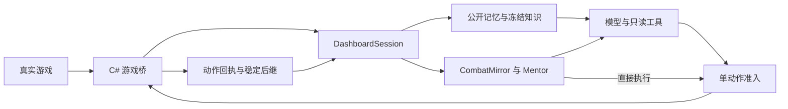

<!-- Development backbone, module ownership, and execution boundaries. -->
# 架构与扩展入口

项目以一个 `DashboardSession` 控制真实游戏。CLI 与网页共用观测、预算、决策和动作账本，服务启动时保持暂停。战斗与非战斗可分别选择大模型、Mentor 辅助或 Mentor 直接执行；直接执行不调用模型 API，不支持的局面会明确暂停。



## 模块与修改入口

表内 Python 文件位于 `src/sts2_agent/`；Mentor Rust 文件位于 `experiments/mentor_simulation/host/src/`。

| 修改内容 | 入口 |
|---|---|
| 游戏公开字段、token、权限及幂等执行 | `vendor/STS2-Agent/STS2AIAgent/Game/` 的 `FairDecisionProtocol`、`GameStateService`、`GameActionService`；`Server/Router.cs` |
| 桥通信、进程身份与稳定等待 | `bridge.py` |
| 会话、预算、暂停恢复、动作准入 | `session.py`；CLI 包装 `controller.py` |
| 公开状态、历史与动作验证 | `public.py`、`public_history.py`、`rules.py` |
| 模型请求、提示与输入投影 | `provider.py`、`prompt_context.py`、`prompt_projection.py`、`model_view.py` |
| 只读工具、知识与攻略 | `model_tools.py`、`knowledge.py`、`strategies.py` |
| 公开记忆、人工指导与自动单步流程 | `memory.py`、`instructions.py`、`automatic.py` |
| 镜像与推演调用 | `mentor_runtime.py`、`simulation.py`；Rust `public.rs`、`production.rs` |
| Mentor 网络与策略适配 | Rust `networks.rs`、`mcts.rs`、`ppo.rs` |
| 网页、历史、遥测与回放 | `dashboard.py`、`web/`、`history.py`、`telemetry.py`、`replay.py` |
| 游戏启动与全解锁存档检查 | `game_launcher.py`、`save_guard.py` |
| 规则验证与策略对照 | `experiments/native_oracle/`、`experiments/solver_validation/`、`experiments/policy_evaluation/` |

新增功能优先放入对应模块，复用现有会话与动作链，不另建控制器或模拟器。

## 必须保持的合同

- **公开信息。** 模型只接收白名单公开状态、同局公开记忆与冻结知识。公开以人类理论可观察或推断为准。新字段须同时维护白名单与公共 token，不能恢复原始状态兜底。
- **镜像与搜索。** `CombatMirror` 可用真实牌序、RNG 和机械状态校准已发生事件，但真值留在私域。公开搜索在镜像副本上先运行 BeliefDraw，再做先验、过滤和预览。校准后的相等不证明此前预测正确；预测验证应比较校准前的结果。
- **真实动作。** 桥在游戏线程校验 token、当前句柄与权限，相同 `action_id` 返回原回执。HTTP 结果未知时，只查同一 PID/instance 的回执，不能重复 POST 或删除 pending 记录绕过未明动作。
- **稳定后继。** 提案生成后重新读取 settled 根；每个真实动作后重新观察。战斗需要 `Phase == Play`、合法权限及连续 ready 稳定帧，选择界面使用自己的权限。这不证明所有异步抽牌均已结束。
- **暂停与取消。** 暂停或停止取消未完成模型生成，阻止重试、工具续接及格式修复；恢复重新生成被取消的决策，部分回答不进入上下文。已完成缓存重新校验，已提交游戏动作仍按原回执结算。
- **持久性与预算。** 会话保存预算、公开记忆、缓存提案与在途动作。工具续接、重试和格式修复均计请求预算；暂停、取消及升级不退款。规则身份改变可废弃提案，但不能抹掉在途动作证据。
- **职责分离。** 只读工具不能执行游戏动作；`automatic.py` 只处理已审核单步流程并走相同准入链。辅助模式保留模型选择，直接模式只执行当前首动作。推演失败须说明原因，不自动切换付费模型。

`build_plan` 跨房间保留，`scene_plan` 与对话绑定当前场景。后台动作审计使用冻结的动作前根，不改动作、不重发，也不覆盖后续决策展示。

## 开发验证

按修改范围选择检查，命令在项目根目录运行：

```powershell
.venv/Scripts/python.exe -m pytest tests/test_session_controls.py tests/test_executor.py tests/test_public_history.py
.venv/Scripts/python.exe -m pytest tests/test_mentor_runtime.py tests/test_simulation.py
```

构建与运行见[本机手册](local-runbook.md)，推演合同与验证范围见[推演与验证](combat-simulation.md)，前端及工具扩展分别见[仪表盘开发](dashboard.md)和[模型工具](model-tools.md)。离线接口与规则检查通过，不等于实机整局覆盖或胜率证明。
